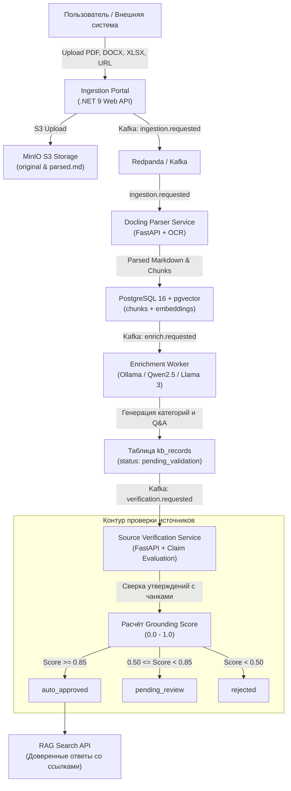

# Enterprise RAG Knowledge Base Pipeline

[](https://dotnet.microsoft.com/)
[](https://www.python.org/)
[](https://fastapi.tiangolo.com/)
[](https://github.com/pgvector/pgvector)
[](https://redpanda.com/)
[](https://min.io/)
[](https://docs.docker.com/compose/)

Пайплайн построения доверенной корпоративной базы знаний для **RAG (Retrieval-Augmented Generation)** с обязательным циклом извлечения вопросов/ответов (Q&A) и **автономным сервисом верификации источника (Source Verification Service)**.

---

## 💡 Решаемая проблема

Классический RAG часто страдает от двух критических недостатков:
1. **Фрагментация контекста:** текст нарезается на «слепые» чанки по 500 токенов, разрывая таблицы, списки и логические цепочки.
2. **Галлюцинации LLM:** нет гарантии, что сгенерированный ответ опирается исключительно на факты из источника, а не додуман моделью.

**Решение в этом проекте:**  
Документы не просто нарезаются на чанки, а преобразуются в **структурированные фактологические пары «Вопрос — Ответ»** с категориями и подкатегориями. Каждый ответ проходит через **независимый «детектор лжи» (Source Verification Service)**, который по предложениям сверяет факты с оригиналом документа и присваивает статус доверия (`auto_approved`, `pending_review`, `rejected`).

---

## 🏗 Архитектура системы



---

## 🧩 Компоненты решения

### 1. Ingestion Portal (`src/KnowledgeService`)
* **Стек:** C#, ASP.NET Core (.NET 9), REST API, OpenAPI.
* **Функции:**
  * Приём и валидация входящих документов (до 50 MB) и веб-страниц по URL (`/api/v1/source/upload`, `/api/v1/source/url`).
  * Трекинг жизненного цикла обработки задач (`jobs`): `queued -> parsing -> chunking -> indexing -> enriching -> validating -> completed`.
  * Эндпоинты модерации для операторов (`/api/v1/review/records/{id}/approve` и `/reject`).
  * RAG Search API (`/api/v1/knowledge/search`) с гибридным поиском.

### 2. Source Verification Service (`workers/verification_worker`)
* **Стек:** Python 3.11, FastAPI, Pydantic, эвристический и NLP-анализ утверждений.
* **Ключевой функционал:**
  * **Два режима запуска:**
    1. *Pipeline режим:* автоматическая сверка сразу после генерации Q&A через брокер сообщений.
    2. *Standalone HTTP API (`POST /api/v1/verification/runs`):* возможность в любой момент перепроверить одну запись, конкретный источник или всю базу знаний целиком (например, при обновлении нормативной документации).
  * **Пофактовый отчёт:** разбиение ответа на клеймы (`claims`), классификация каждого клейма (`supported`, `not_found`, `contradicted`), расчёт метрики `grounding_score` и сохранение трассировки доказательств (`evidence_spans`).

### 3. Enrichment Worker (`workers/enrichment_worker`)
* **Стек:** Python, Ollama API, JSON Schema.
* **Функции:**
  * Анализирует заголовок и оглавление источника для формирования иерархии категорий и подкатегорий.
  * Батчами (по 3–5 чанков) генерирует целевые вопросы и фактологические ответы строго в рамках контекста.

### 4. Docling Microservice (`workers/docling_service`)
* **Стек:** FastAPI, Docling (IBM Granite OCR/Layout analysis).
* **Функции:** Извлечение структурированного Markdown из сложных PDF с сохранением таблиц и метаданных.

---

## 🗄 Модель данных (PostgreSQL + pgvector)

- **`jobs`**: полный статус выполнения пайплайна, счётчики сгенерированных и одобренных вопросов.
- **`sources`**: метаданные источника, URI в S3, контрольная сумма (SHA-256) для дедупликации.
- **`chunks`**: нарезка текста с векторными эмбеддингами `vector(1024)` для семантического поиска.
- **`kb_records`**: готовые пары «Вопрос — Ответ», категория, подкатегория, статус модерации, `grounding_score` и JSON-отчёт проверки.
- **`validation_runs`** & **`validation_run_items`**: аудит-лог всех прогонов верификации с детализацией по каждой записи.

---

## 🚀 Быстрый старт

### 1. Поднятие инфраструктуры

В корне проекта запустите Docker Compose:

```bash
docker compose up -d
```

Поднимутся следующие сервисы:
* **PostgreSQL 16 (pgvector):** `localhost:5432`
* **Redpanda (Kafka API):** `localhost:19092`
* **Redpanda Web Console:** `http://localhost:8085`
* **MinIO Storage & Console:** `http://localhost:9000` / `http://localhost:9001` (login: `minioadmin`, pass: `minioadminpassword`)
* **Redis:** `localhost:6379`

### 2. Запуск C# Ingestion Portal

```bash
cd src/KnowledgeService
dotnet run
```

Swagger UI будет доступен по адресу `https://localhost:7001/openapi/v1.json` или через Visual Studio.

### 3. Запуск Source Verification Service

```bash
cd workers/verification_worker
pip install fastapi uvicorn pydantic
python app.py
```

Сервис запустится на порту `http://localhost:8001`. Документация Swagger доступна по адресу `http://localhost:8001/docs`.

---

## 📡 Примеры API

### Проверка ответа через Source Verification (Standalone)

```http
POST /api/v1/verification/verify-single
Content-Type: application/json

{
  "record_id": "c9b2e04e-5a7a-4c27-9911-37f07cd75e01",
  "question": "Какие типы кораблей поддерживаются в системе?",
  "answer": "В игре есть 4 типа кораблей: линкор на 4 палубы, крейсеры, эсминцы и катера.",
  "context_chunks": [
    "В системе SeaBattle поддерживается 4 типа кораблей: 1 линкор (4 палубы), 2 крейсера (3 палубы), 3 эсминца (2 палубы) и 4 катера (1 палуба)."
  ]
}
```

**Ответ:**

```json
{
  "record_id": "c9b2e04e-5a7a-4c27-9911-37f07cd75e01",
  "grounded": true,
  "grounding_score": 0.95,
  "status": "auto_approved",
  "claims": [
    {
      "claim": "В игре есть 4 типа кораблей: линкор на 4 палубы, крейсеры, эсминцы и катера",
      "status": "supported",
      "overlap_ratio": 0.88
    }
  ],
  "contradictions": [],
  "evidence_spans": [
    "В системе SeaBattle поддерживается 4 типа кораблей: 1 линкор (4 палубы)..."
  ]
}
```

---

## 📄 Лицензия

Проект распространяется под лицензией MIT.
