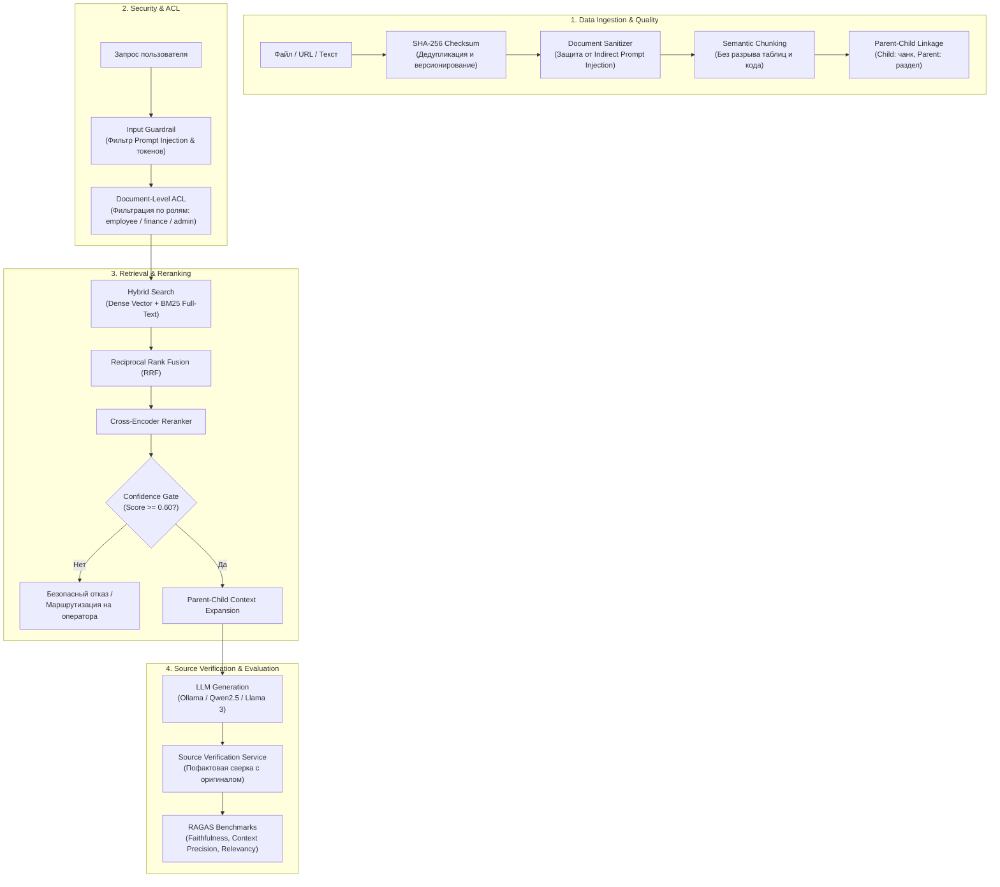

# Enterprise Production RAG Knowledge Base Pipeline

[](https://dotnet.microsoft.com/)
[](https://www.python.org/)
[](https://fastapi.tiangolo.com/)
[](https://github.com/pgvector/pgvector)
[](https://redpanda.com/)
[](https://min.io/)
[](https://docs.docker.com/compose/)

Отказоустойчивый, масштабируемый и готовый к production пайплайн корпоративной базы знаний для **RAG (Retrieval-Augmented Generation)**. Включает семантический чанкинг, гибридный поиск, безопасность на уровне ролей (ACL), защиту от инъекций (Guardrails) и оценку качества ответов (RAGAS).

---

## 🎯 Ключевые уровни Production-архитектуры



---

### 1. Качество данных и инжеста (Data Ingestion & Chunking)
* **Интеллектуальный чанкинг (Semantic Chunking):** Реализован в `workers/processing_worker/semantic_chunker.py`. Учитывает разметку Markdown, заголовки, не разрывает таблицы (`| col | col |`) и изолирует блоки исходного кода (````...````).
* **Parent-Child контекст:** Для векторного индекса генерируются компактные дочерние чанки (Child), но они хранят ссылку на родительский контекстный блок раздела (`parent_text`), чтобы LLM получала полную картину абзаца.
* **Дедупликация и версионирование:** Документы хешируются по SHA-256. При обновлении источника старые векторные чанки помечаются `is_active = FALSE` или удаляются каскадно, предотвращая конфликты устаревших данных.
* **Мультимодальный парсинг (Docling):** Сервис `workers/docling_service` извлекает структурированный текст и таблицы из PDF и офисных форматов.

### 2. Точность поиска и извлечения (Retrieval Quality)
* **Гибридный поиск (Hybrid Search):** Объединение плотного векторного поиска (Cosine Distance по pgvector) и лексического поиска (BM25 / `tsvector` с русским словарем) через **Reciprocal Rank Fusion (RRF)**:
  $$RRF(d) = \sum_{m \in \{vec, bm25\}} \frac{1}{k + rank_m(d)}$$
* **Переранжирование (Cross-Encoder Reranking):** Модуль переранжирования оценивает релевантность кандидатов под точные термины запроса и отсекает шум.
* **Confidence Gate & Fallbacks:** Если итоговая уверенность поисковой выдачи ниже порога ($< 0.60$), система выдает безопасное предупреждение и передает запрос оператору поддержки, предотвращая генерацию галлюцинаций.

### 3. Безопасность и контроль доступа (Security & Governance)
* **Document-Level ACL (Контроль доступа на уровне документов):** В схеме БД `chunks`, `sources` и `kb_records` содержат массив `allowed_roles TEXT[]`. Поисковый запрос отфильтровывает чанки, к которым у пользователя нет допуска (например, сотрудник не увидит финансовые отчеты или секретные документы).
* **Защита от Indirect Prompt Injection:** Все индексируемые документы проходят проверку на скрытые враждебные инструкции (`ignore previous instructions`, `system override`, инъекции скриптов) перед нарезкой и записью в векторную базу.
* **Входные Guardrails:** Защита от джейлбрейков, инъекций и спама токенами на входе пользовательского API.

### 4. Наблюдаемость и оценка (Observability & Evaluation)
* **Трассировка запросов (Query Traces):** Таблица `query_traces` сохраняет `trace_id`, `latency_ms`, `tokens_used`, использованный режим поиска и флаг срабатывания фолбэка.
* **RAG Evaluation Framework:** Модуль `workers/evaluation/rag_evaluator.py` вычисляет ключевые метрики качества:
  * **Faithfulness:** доля фактов ответа, подтвержденных контекстом.
  * **Context Precision:** точность ранжирования чанков в поисковой выдаче.
  * **Answer Relevancy:** смысловое соответствие ответа исходному вопросу.

---

## 🗄 Структура базы данных (`db/init.sql`)

```sql
-- Chunks: Семантические чанки с полнотекстовым поиском и ACL
CREATE TABLE chunks (
    id UUID PRIMARY KEY DEFAULT uuid_generate_v4(),
    source_id UUID REFERENCES sources(id) ON DELETE CASCADE,
    parent_text TEXT,                                            -- Parent-Child контекст
    text TEXT NOT NULL,
    search_vector tsvector GENERATED ALWAYS AS (to_tsvector('russian', text)) STORED, -- BM25
    embedding vector(1024),                                      -- Векторное пространство
    allowed_roles TEXT[] DEFAULT ARRAY['employee']::TEXT[]       -- Document-Level ACL
);

-- Query Traces: Наблюдаемость и аудит поиска
CREATE TABLE query_traces (
    id UUID PRIMARY KEY DEFAULT uuid_generate_v4(),
    trace_id VARCHAR(64) NOT NULL,
    query TEXT NOT NULL,
    routed_to_fallback BOOLEAN DEFAULT FALSE,
    latency_ms INT,
    tokens_used INT
);
```

---

## 🚀 Быстрый запуск

### 1. Запуск инфраструктуры (Docker Compose)

```bash
docker compose up -d
```

Сервисы:
* **PostgreSQL 16 + pgvector:** `localhost:5432`
* **Redpanda (Kafka API):** `localhost:19092`
* **Redpanda Console:** `http://localhost:8085`
* **MinIO S3 Storage:** `http://localhost:9000` (Console: `:9001`)
* **Redis:** `localhost:6379`

### 2. Запуск .NET Ingestion Portal

```bash
cd src/KnowledgeService
dotnet run
```

Эндпоинт поиска с поддержкой ACL:
```http
GET /api/v1/knowledge/search?query=архитектура+пайплайна
X-User-Roles: employee
```

### 3. Тестирование качества поиска и Guardrails

```bash
cd workers/retrieval_service
python engine.py
```

### 4. Запуск бенчмарка метрик RAG (Evaluation)

```bash
cd workers/evaluation
python rag_evaluator.py
```

---

## 📄 Лицензия

MIT License.
